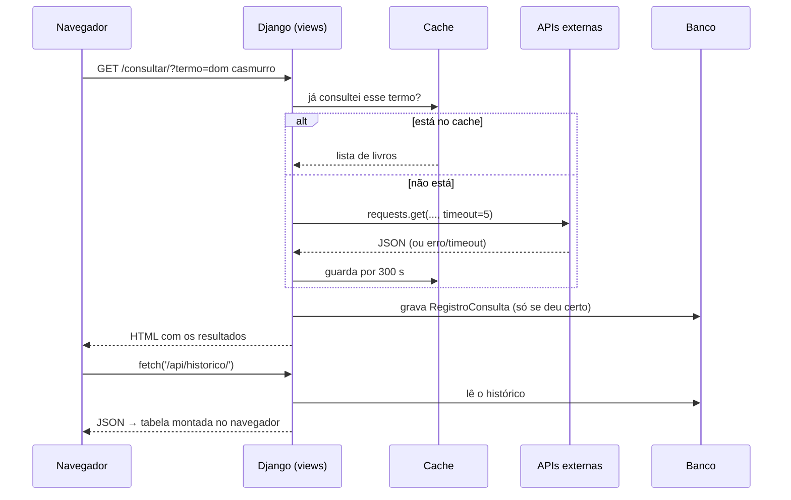

# 📚 Painel da Biblioteca — Projeto 4 (Django + APIs externas + `fetch()`)

Sistema de **Biblioteca** que consulta livros na **Open Library** e o tempo na **Open-Meteo** (duas APIs públicas, gratuitas e sem chave), grava cada consulta no banco, expõe uma API própria e monta as tabelas e gráficos no navegador com `fetch()`. Projeto da disciplina **Construção de Backend** (IESB), baseado no *Guia do Aluno — Projeto 4 (Painel de Cotações & Clima)*, reaproveitando a estrutura do **Projeto 3** (API REST com Token, isolamento por usuário, paginação opcional, deploy no Render) e com os **desafios extras** incluídos.

> ### ⚠️ Estado de verificação (leia antes de entregar)
> Este projeto foi escrito num ambiente **sem Django instalado e sem acesso à internet**. Por isso:
>
> | O que foi feito e conferido | O que **ainda não foi executado** (faça no seu computador) |
> |---|---|
> | Todo o código Python compila (`py_compile`) | `makemigrations`, `migrate`, `runserver` |
> | **16 testes** de `tests_servicos.py` (regras puras, parsing da Open Library/Open-Meteo, multa) **rodaram e passaram** | **36 testes** que dependem do Django (`tests.py` = 8 do guia, `tests_extras.py` = 28) — escritos, **nunca rodados** |
> | Todos os nomes de rota usados em templates e testes existem em `urls.py` | Chamadas reais à Open Library e à Open-Meteo |
> | Templates + CSS + JavaScript renderizados num Chromium com **dados simulados** (as 3 *prévias* abaixo) | `git push` e deploy no Render |
>
> Se algum teste falhar na primeira execução, o erro mais provável está no código/teste escrito às cegas, não na sua máquina: veja [Dificuldades](#-dificuldades-encontradas).

---

## 📑 Sumário
1. [Visão geral e requisitos](#-visão-geral-e-requisitos)
2. [Tecnologias e estrutura](#-tecnologias-e-estrutura)
3. [Como rodar (Windows)](#-como-rodar-no-windows)
4. [Passo a passo da construção](#-passo-a-passo-da-construção)
5. [Desafios extras](#-desafios-extras-o-que-foi-acrescentado)
6. [Referência da API](#-referência-da-api)
7. [Fluxo de funcionamento (com prints)](#-fluxo-de-funcionamento-com-prints)
8. [Dificuldades encontradas](#-dificuldades-encontradas)
9. [Checklist de entrega](#-checklist-de-entrega)
10. [Publicação (GitHub e Render)](#-publicação-github-e-render)
11. [Limitações e próximos passos](#-limitações-e-próximos-passos)

---

## 🎯 Visão geral e requisitos

O guia pede um painel que consulta uma API externa, **guarda cada resultado**, **trata falhas** e **mostra o histórico com `fetch()`**. Aqui o tema "cotação do dólar" virou **biblioteca**, mantendo todos os requisitos:

| Requisito do guia | Como ficou na Biblioteca |
|---|---|
| Consultar a API externa em `/consultar/` e salvar **um registro a cada consulta** | `/consultar/?termo=...` consulta a **Open Library** (título, autor ou ISBN) e grava um `RegistroConsulta` |
| `RegistroCotacao` com `DecimalField` | `RegistroConsulta` (histórico) + `RegistroClima` (`temperatura` em `DecimalField`) + `Emprestimo.multa` (**Decimal**, nunca `float`) |
| `requests.get(url, timeout=5)` + `raise_for_status()` | `servicos.buscar_livros` / `buscar_clima` (timeout vem de `TIMEOUT_API`, padrão **5**) |
| `try/except`: falha de rede não derruba a página | A View captura `RequestException` (rede/timeout/HTTP) e `ValueError, KeyError, TypeError, InvalidOperation` (formato inesperado) |
| `/api/historico/` (JSON, do mais recente ao mais antigo, somente leitura) | `HistoricoConsultaView` (`ListAPIView`; `POST` → 405) |
| Tabela montada no navegador com `fetch()`, erro com `.catch()` | `/` e `/consultar/` montam as tabelas com `fetch()`; `.catch()` mostra mensagem amigável |
| URL da API em variável de ambiente | `OPENLIBRARY_URL`, `CLIMA_URL`, `TIMEOUT_API`... (veja `.env.example`) |

**Além do guia — o que torna isto uma biblioteca de verdade:** acervo (`Livro`), empréstimos por usuário com **devolução, prazo, limite de 3 ativos e multa de R$ 0,50 por dia de atraso**, importação de resultados da Open Library para o acervo e painel com números e gráficos.

---

## 🧰 Tecnologias e estrutura

Python 3.12 · Django 6.1 · Django REST Framework 3.18 · `requests` · SQLite (padrão) ou PostgreSQL via `DATABASE_URL` · WhiteNoise + gunicorn (produção).

```
Projeto 4/
├── manage.py · requirements.txt · .gitignore · .env.example · README.md
├── Procfile · render.yaml                # deploy (herdado do Projeto 3)
├── bibliotecaapi/                        # configuração: settings.py, urls.py, wsgi.py, asgi.py
├── biblioteca/
│   ├── models.py                         # Livro, Emprestimo, RegistroConsulta, RegistroClima
│   ├── servicos.py                       # chamadas às APIs externas + regras puras (SEM Django)
│   ├── consultas.py                      # junta serviços + cache + banco
│   ├── serializers.py · views.py · urls.py · admin.py · pagination.py
│   ├── templates/biblioteca/             # base.html, index.html (painel), consultar.html
│   ├── static/biblioteca/                # estilo.css, graficos.js (gráficos em <canvas>)
│   ├── management/commands/              # popular_dados.py, consultar_agendado.py
│   ├── tests.py                          # os 8 testes do guia, adaptados
│   ├── tests_extras.py                   # 28 testes dos extras
│   └── tests_servicos.py                 # 16 testes puros (rodam até sem Django)
└── docs/
    ├── gerar_prints.py                   # prints REAIS (servidor rodando)
    ├── gerar_previas.py                  # prévias SEM Django (dados simulados)
    └── prints/
```

> `servicos.py` **não importa o Django** de propósito: assim a parte mais arriscada (falar com APIs de terceiros e interpretar o JSON) pode ser testada sem banco, sem servidor e sem internet.

---

## 🚀 Como rodar (no Windows)

```bat
cd "C:\Users\caios\OneDrive\Documentos\Faculdade\Projeto 4"
python -m venv venv
venv\Scripts\activate
pip install -r requirements.txt
python manage.py makemigrations biblioteca
python manage.py migrate
python manage.py test
python manage.py createsuperuser
python manage.py popular_dados --senha SUASENHA --historico-demo   :: opcional
python manage.py runserver
```

- Páginas: `http://127.0.0.1:8000/` (painel) e `/consultar/` · Admin: `/admin/` · API navegável: `/api/livros/`.
- `makemigrations` **é obrigatório na primeira vez**: as migrations não vieram prontas porque não deu para rodar o Django onde o projeto foi escrito (veja D01). Depois, faça `git add biblioteca/migrations` e commite.
- `--historico-demo` cria consultas e leituras de clima **fictícias** (termo marcado como "dado de demonstração") só para os gráficos não ficarem vazios. Sem a flag, os gráficos enchem conforme você usa.
- Linux/macOS: `source venv/bin/activate` e `export VARIAVEL=valor`.
- Variáveis de ambiente (todas opcionais em desenvolvimento): `SECRET_KEY`, `DEBUG`, `ALLOWED_HOSTS`, `CSRF_TRUSTED_ORIGINS`, `DATABASE_URL`, `OPENLIBRARY_URL`, `CLIMA_URL`, `CLIMA_CIDADE`, `CLIMA_LATITUDE`, `CLIMA_LONGITUDE`, `TIMEOUT_API`, `CACHE_SEGUNDOS`, `AGENDADOR_TERMOS`.

---

## 🧱 Passo a passo da construção

Cada passo segue o *Guia do Aluno* e termina com o seu **Checkpoint** (o que você deve ver ao rodar).

| # | Passo | O que foi feito | Checkpoint |
|---|---|---|---|
| 1 | **Ambiente** | `venv`, `pip install django djangorestframework requests` (+ extras do Projeto 3: `dj-database-url`, `whitenoise`, `gunicorn`, `psycopg`), projeto `bibliotecaapi` e app `biblioteca`. O `requirements.txt` já vem com versões fixas. | `runserver` mostra o foguete do Django |
| 2 | **Apps e URL externa** | `rest_framework`, `rest_framework.authtoken` e `biblioteca` em `INSTALLED_APPS`; `OPENLIBRARY_URL`, `CLIMA_URL`, `TIMEOUT_API`... lidos com `os.environ.get(..., padrão)` — **nenhuma URL ou segredo fixo no código**. | `manage.py check` sem erros |
| 3 | **Models** | `RegistroConsulta` (equivale ao `RegistroCotacao`), `RegistroClima` (`DecimalField`), `Livro` e `Emprestimo`. `Meta.ordering = ['-data_hora_consulta', '-id']` deixa o mais recente primeiro. | — |
| 4 | **Migrations e Admin** | `makemigrations biblioteca` + `migrate`; os 4 models registrados no Admin com `list_display`, filtros e busca. | A migration lista `Create model RegistroConsulta` (e os outros 3) |
| 5 | **Serializers** | `RegistroConsultaSerializer` (`fields = '__all__'`, como no guia), `LivroSerializer`, `EmprestimoSerializer`, etc. | — |
| 6 | **Views** | `consultar_livros` (HTML) com `try/except` e `timeout`; `HistoricoConsultaView` (`ListAPIView`). A lógica de consulta ficou em `consultas.py` e as chamadas HTTP em `servicos.py`. | — |
| 7 | **URLs** | `biblioteca/urls.py` incluído por `bibliotecaapi/urls.py`. | `/consultar/` e `/api/historico/` respondem |
| 8 | **Templates com `fetch()`** | `consultar.html` e `index.html`: a tabela começa `hidden` e o JavaScript a preenche com `textContent` (nunca `innerHTML`); erro de rede cai no `.catch()`. | Tabela aparece sem recarregar a página |
| 9 | **Teste manual (inclusive os erros)** | Veja o [roteiro](#roteiro-do-passo-9) abaixo. | Tabela de 7 verificações |
| 10 | **Testes automatizados** | `tests.py` = os 8 testes do guia (mock de `requests.get`); `tests_extras.py` e `tests_servicos.py` cobrem os extras. | `python manage.py test` termina em `OK` |
| 11 | **GitHub** | `.gitignore` (venv, `db.sqlite3`, `.env`, `staticfiles/`), `requirements.txt`, este README. | Repositório público com prints |

### Roteiro do passo 9
Rode `python manage.py runserver` e confira (marque ☐ → ☑ conforme testar):

| # | Ação | Resultado esperado | OK |
|---|---|---|---|
| 1 | Abrir `/consultar/?termo=dom casmurro` | Faixa verde "Consulta registrada" + cartões de livros; nova linha na tabela | ☐ |
| 2 | Repetir a mesma consulta | Etiqueta **"respondida pelo cache"**; a API externa não é chamada de novo | ☐ |
| 3 | Abrir `/api/historico/` | JSON, mais recente primeiro | ☐ |
| 4 | Abrir o Admin → *Registros de consulta* | Os mesmos registros | ☐ |
| 5 | **Erro no servidor:** parar o servidor, `set OPENLIBRARY_URL=https://openlibrary.org/nao-existe.json`, reiniciar, consultar | Faixa vermelha amigável, página não quebra, **nenhum registro novo** | ☐ |
| 6 | **Erro no navegador:** F12 → Network → *Offline* → recarregar | "Não foi possível carregar…" na tabela; erro no Console | ☐ |
| 7 | Apagar registros no Admin e abrir `/consultar/` | "Nenhuma consulta registrada ainda." | ☐ |

> Depois do teste 5, feche o terminal (ou apague a variável) para voltar à URL padrão. O cache é **por processo**; reinicie o servidor se quiser forçar uma consulta "fria".

---

## ✨ Desafios extras: o que foi acrescentado

O guia chama estes itens de opcionais; sem eles o sistema ficaria só com a consulta, então todos foram feitos, adaptados ao tema.

| Desafio do guia | Como ficou na Biblioteca | Onde |
|---|---|---|
| **Múltiplas moedas** | **Vários termos numa consulta só**: `?termo=dom casmurro, clarice lispector` (até 5), cada um com seu registro | `views.consultar_livros` |
| **Gráfico de variação** | Painel com **barras de consultas por dia** e **linha da variação da temperatura**, desenhados em `<canvas>` | `static/biblioteca/graficos.js` |
| **Cache** | `django.core.cache` guarda a resposta por `CACHE_SEGUNDOS` (300). O histórico marca `veio_do_cache` e o painel mostra o % de acertos | `consultas.py` |
| **Consultas agendadas** | `python manage.py consultar_agendado` consulta termos e clima sozinho; saída ≠ 0 se algo falhar (bom para cron/Agendador do Windows) | `management/commands/consultar_agendado.py` |
| **API de clima** | **Open-Meteo** (sem chave): `/api/clima/atual/` mostra o tempo na biblioteca, grava `RegistroClima` e dá uma sugestão de leitura | `servicos.buscar_clima`, `consultas.atualizar_clima` |

**Extras do sistema de biblioteca (criatividade):**
- **Acervo** (`/api/livros/`): busca `?search=`, filtro `?disponivel=true`, ordenação `?ordering=`, paginação opcional (herdada do Projeto 3) — leitura pública, escrita só da **equipe** (`is_staff`).
- **Importar para o acervo**: botão em cada resultado da consulta (usa a sessão do Admin + token CSRF).
- **Empréstimos por usuário** (como as tarefas do Projeto 3): cada pessoa só vê os próprios; ID alheio devolve **404**.
- **Regras de negócio**: prazo padrão de 14 dias, limite de 3 empréstimos ativos, estoque (`exemplares_disponiveis`) baixa no empréstimo e volta na devolução, **multa de R$ 0,50/dia** calculada com `Decimal`.
- **Segurança**: `select_for_update` ao pegar o último exemplar; ISBN em branco vira `NULL`; `textContent` no JavaScript; nenhuma senha no repositório (`popular_dados` exige `--senha`).
- **Cadastro e login** por token: `/api/registro/` e `/api/login/`.

---

## 🔌 Referência da API

Permissões: 🌐 público · 🔑 exige `Authorization: Token <token>` · 🛡️ só equipe (`is_staff`).

| Método e rota | Acesso | O que faz |
|---|---|---|
| `GET /` · `GET /consultar/?termo=` | 🌐 | Páginas HTML (painel e consulta) |
| `GET /api/historico/` | 🌐 | Histórico de consultas (array; `?page_size=` pagina) · `POST` → 405 |
| `GET /api/clima/atual/` | 🌐 | Clima atual (cache 5 min); `503` amigável se a API cair |
| `GET /api/clima/` | 🌐 | Histórico de leituras de clima |
| `GET /api/estatisticas/` | 🌐 | Totais e séries dos gráficos |
| `GET /api/livros/` · `GET /api/livros/<id>/` | 🌐 | Acervo (`?search=`, `?disponivel=`, `?ordering=`, `?page_size=`) |
| `POST/PUT/PATCH/DELETE /api/livros/...` | 🛡️ | Cadastro e edição do acervo |
| `GET/POST /api/emprestimos/` | 🔑 | Meus empréstimos (`?ativo=`, `?atrasado=true`) · pegar livro: `{"livro": 1}` |
| `GET /api/emprestimos/<id>/` | 🔑 | Detalhe (outro usuário → 404) |
| `POST /api/emprestimos/<id>/devolver/` | 🔑 | Devolve, repõe o estoque e mostra a multa |
| `POST /api/registro/` · `POST /api/login/` | 🌐 | Cria conta / devolve o token |

Exemplo (formato ilustrativo — rode no seu computador para ver os valores reais):

```bash
curl -X POST http://127.0.0.1:8000/api/login/ -d "username=ana&password=SUASENHA"     # -> {"token": "..."}
curl -X POST http://127.0.0.1:8000/api/emprestimos/ -H "Authorization: Token $TOKEN" -d "livro=1"
curl -X POST http://127.0.0.1:8000/api/emprestimos/1/devolver/ -H "Authorization: Token $TOKEN"
```

> Nunca cole um token ou senha reais no README, em prints ou no repositório.

---

## 🖼️ Fluxo de funcionamento (com prints)

> **Sobre os prints:** as imagens abaixo são **PRÉVIAS com dados simulados**, geradas sem servidor Django (faixa dourada no topo de cada imagem). O HTML, o CSS e o JavaScript são os do projeto, mas os dados vêm de respostas falsas. **Gere os prints reais** com `python docs/gerar_prints.py` (servidor rodando, com internet) e troque as imagens deste README.

### Visão geral



### 1. Painel (`/`)


1. O navegador recebe só a "casca" HTML; **tudo o resto vem de `fetch()`** às APIs do próprio projeto.
2. `/api/clima/atual/` consulta a Open-Meteo (ou o cache), grava uma leitura e devolve temperatura, descrição e uma sugestão de leitura.
3. Só **depois** o painel pede `/api/estatisticas/`, para que a leitura recém-gravada já entre no gráfico de temperatura.
4. `/api/livros/?page_size=8` preenche o acervo (com busca e paginação) e `/api/historico/?page_size=8` preenche o histórico.
5. Cada bloco tem o **seu próprio `.catch()`**: se uma API falhar, só aquele bloco mostra a mensagem, o resto da página continua funcionando.

### 2. Consultar livros (`/consultar/`)


1. O formulário envia `?termo=dom casmurro, clarice lispector` (até 5 termos separados por vírgula).
2. Para **cada** termo a View pergunta ao cache; se não houver, chama a Open Library com `timeout=5`.
3. Se deu certo, grava **um** `RegistroConsulta` (com quantidade de resultados, primeiro título, tempo gasto e se veio do cache) e mostra a faixa verde. ISBN (10 ou 13 dígitos) é detectado e vira busca exata.
4. Cada cartão tem **Importar para o acervo**: o JavaScript faz `POST /api/livros/` com a sessão do Admin e o token CSRF. Sem login de equipe aparece um aviso explicando o que fazer.

### 3. Quando a API externa falha


- **No servidor:** timeout, rede fora ou HTTP 4xx/5xx viram exceção (`raise_for_status`), a View captura e mostra a mensagem em vermelho; **nada é gravado** e a página não quebra. Se a API responder com JSON diferente do esperado, a mensagem é de "formato inesperado".
- **No navegador:** se `/api/historico/` falhar, o `.catch()` troca "Carregando..." por "Não foi possível carregar o histórico".

### 4. Empréstimos (API com token)
`POST /api/login/` → token → `POST /api/emprestimos/ {"livro": 1}` baixa um exemplar e define o prazo (hoje + 14 dias) → `POST /api/emprestimos/1/devolver/` repõe o exemplar e informa `dias_atraso` e `multa`. Beto não consegue ver nem devolver o empréstimo da Ana (404).

### Prints reais a gerar
`python docs/gerar_prints.py` cria em `docs/prints/`: `01-painel`, `02-consultar-resultados`, `03-consultar-cache`, `04-api-historico`, `05-api-livros`, `06-api-clima`, `07-emprestimos-da-ana`, `08-emprestimos-atrasados`, `09-isolamento-404`, `10-admin-historico`, `11-admin-emprestimos`. Depois, acrescente ao README as imagens que quiser.

---

## 🧗 Dificuldades encontradas

A coluna **Origem** diz o quanto cada item foi comprovado — **Observado**: aconteceu durante a construção. **Previsto**: identificado ao ler o guia/projetar o código; a correção já foi escrita junto, mas **não reproduzi o erro sem ela**.

| ID | Dificuldade | Origem | Causa → o que foi feito |
|---|---|---|---|
| D01 | **Não foi possível rodar o Django onde o projeto foi escrito** | Observado | Ambiente sem Django e sem internet (`pip` sem acesso). Consequências: sem `makemigrations`/`runserver`/testes do Django e sem chamadas reais às APIs. Contornos: `servicos.py` sem dependência do Django (+16 testes que rodaram), prévias das telas com dados simulados, e **migrations não incluídas** (preferi não escrevê-las à mão: um erro silencioso seria pior que um comando a mais). |
| D02 | Prévia do painel saiu com defeitos visuais | Observado | Na primeira imagem os rótulos do gráfico de temperatura se sobrepunham e a faixa de aviso (posição fixa) cobria o conteúdo. `graficos.js` passou a mostrar menos rótulos e a faixa virou um elemento no topo da página. |
| D03 | Renderizar os templates fora do Django | Observado | A 1ª tentativa falhou com `TemplateNotFound` (o `` aponta para `biblioteca/base.html`). `gerar_previas.py` converte esse caminho e os poucos recursos do Django (`url`, `static`, `load`) para Jinja2. |
| D04 | Como mapear "Painel de Cotações" para uma Biblioteca sem perder nenhum requisito | Previsto | Tabela de equivalência na [Visão geral](#-visão-geral-e-requisitos): cotação → consulta de livro; `DecimalField` → temperatura e multa; "múltiplas moedas" → vários termos. |
| D05 | O mock dos testes do guia aponta para `painel.views.requests.get` | Previsto | Aqui o `requests` é usado em `servicos.py`; os testes usam `biblioteca.servicos.requests.get` (é o **mesmo** objeto `requests`, então o mock vale para qualquer módulo). |
| D06 | O cache local **persiste entre testes** | Previsto | Um teste "vazaria" o resultado para o seguinte e a API simulada nem seria chamada. Solução: `cache.clear()` no `setUp` de cada classe de teste. |
| D07 | `POST` em `/api/historico/` deve dar **405**, mas o padrão do projeto é `IsAuthenticated` (daria 401) | Previsto | O histórico é público e somente leitura: `permission_classes = [AllowAny]` nesse endpoint. |
| D08 | ISBN `unique` + em branco | Previsto | Dois ISBNs `""` violariam o `unique`. `validate_isbn` transforma vazio em `None` (NULL); o Admin faz o mesmo para campos `null=True`. |
| D09 | Botão "Importar" faz `POST` no navegador, mas a API usa Token | Previsto | A página usa a sessão do Admin (`SessionAuthentication` já vem depois do Token) e envia `X-CSRFToken` lido de um `<meta>`. Sem login: 401/403 → aviso claro, sem quebrar. |
| D10 | Duas pessoas pegando o último exemplar ao mesmo tempo | Previsto | `transaction.atomic()` + `select_for_update()` no livro. Em SQLite o bloqueio é ignorado; **não validei em PostgreSQL**. |
| D11 | `const status = ...` no JavaScript do guia colide com `window.status` do navegador | Previsto | Variável renomeada para `statusHistorico`. |
| D12 | O guia grava no banco num `GET` (`/consultar/`) | Previsto | Mantido como no guia (é o objetivo didático). Efeito colateral: atualizar a página repete a consulta. Em projeto real seria `POST`. |
| D13 | Gráfico: Chart.js (CDN) ou `<canvas>` próprio | Previsto | Escolhi `<canvas>` próprio (~80 linhas): funciona offline, sem CDN e sem depender de terceiros. Troque por Chart.js se preferir. |
| D14 | Parâmetros das APIs externas escritos de memória/documentação | Previsto | `fields`, `isbn` e `limit` da Open Library e `current=` da Open-Meteo vêm da documentação pública, **sem chamada real**. Se o passo 9 mostrar "formato inesperado", abra a URL da API no navegador e compare as chaves (`docs`, `current`). |

---

## ✅ Checklist de entrega

**Implementado** = existe no código. **Você confere** = precisa rodar no seu computador (marque ☑ quando ver funcionando).

| Item do guia | Implementado | Você confere |
|---|---|---|
| Model de consulta criado, migrado e visível no Admin | ✔ (migration a gerar) | ☐ |
| `/consultar/` busca e salva um registro a cada consulta | ✔ | ☐ |
| Erro de rede/timeout tratado no servidor, mensagem amigável, página não quebra | ✔ | ☐ |
| Serializer criado e `/api/historico/` do mais recente ao mais antigo | ✔ | ☐ |
| Tabela montada via `fetch()` sem recarregar a página | ✔ (prévia renderizada) | ☐ |
| Erro de rede tratado no navegador com `.catch()` | ✔ (prévia renderizada) | ☐ |
| Projeto roda com `runserver` sem erros no terminal | — | ☐ |
| `python manage.py test` passa (52 testes: 8 do guia + 28 extras + 16 puros) | 16 puros ✔ rodaram | ☐ |
| Repositório público com README (prints), `requirements.txt` e `.gitignore` | ✔ (arquivos prontos) | ☐ publicar |
| Desafios extras (vários termos, gráfico, cache, agendado, clima) | ✔ | ☐ |

---

## 🌐 Publicação (GitHub e Render)

O envio ao GitHub e o deploy dependem da **sua conta**; não foram feitos.

```bat
:: 1) dentro da pasta do projeto, com o venv ativo
python manage.py makemigrations biblioteca
python manage.py migrate
python manage.py test
git add .
git commit -m "Projeto 4: migrations da Biblioteca"

:: 2) crie um repositório PÚBLICO vazio no GitHub e cole a URL dele:
git branch -M main
git remote add origin <URL-DO-SEU-REPOSITORIO>
git push -u origin main
```

**Antes do push:** confira que `venv/`, `db.sqlite3` e `.env` **não** aparecem em `git status`, que não há senha/token em nenhum arquivo e que o README mostra os prints (troque as prévias pelos reais).

**Deploy no Render (opcional):** *New → Blueprint* apontando para o repositório (usa o `render.yaml`: serviço web + PostgreSQL gratuito). Depois do deploy, **teste de verdade** `/`, `/consultar/?termo=python` e `/admin/` — o PostgreSQL ainda não foi validado (D10).

**Consultas agendadas:** `python manage.py consultar_agendado --termos "python, django"`. No Windows, use o *Agendador de Tarefas* chamando o `python.exe` do `venv`; no Linux, `*/30 * * * * cd /caminho && venv/bin/python manage.py consultar_agendado`. Lembrete: o cache é por processo, então o comando agendado não compartilha cache com o servidor.

---

## 🚧 Limitações e próximos passos

- **Verificação pendente** (veja o quadro do início): rodar migrations, os 36 testes do Django, as chamadas reais e o deploy.
- Tokens não expiram e login/registro não têm limite de tentativas (aceitável só para fins acadêmicos). Próximo passo: JWT e *throttling* do DRF.
- O cache é local de cada processo (com vários *workers* do gunicorn, cada um tem o seu). Para produção: Redis ou `DatabaseCache`.
- Alterar `exemplares_total` de um livro já cadastrado **não** ajusta `exemplares_disponiveis`.
- A Open Library pede identificação por `User-Agent` (já enviado) e pode limitar abusos; evite consultas agendadas muito frequentes.
- Ideias: renovação de empréstimo, reserva de livro indisponível, e-mail de aviso de atraso.

---
*Projeto 4 — Construção de Backend · IESB · 2026*
